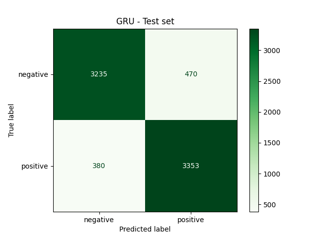

# Movie Review Sentiment Analysis (RNN, LSTM, GRU)

A deep learning project that classifies IMDB movie reviews as **positive** or **negative**. I built and compared three sequence models in PyTorch (Simple RNN, LSTM, GRU) and deployed the best one (GRU) as a Streamlit app.


## Results

Evaluated on a held-out test set of 7,438 reviews:

| Model | Parameters | Test accuracy | Macro F1 |
|---|---|---|---|
| Simple RNN (baseline) | 2,593,153 | 79.8% | 0.798 |
| LSTM | 2,692,225 | 88.1% | 0.881 |
| **GRU (final)** | 2,659,201 | **88.6%** | **0.886** |

- LSTM and GRU improved on the simple RNN by about 8 points. Simple RNNs struggle to remember early words in long reviews.
- The GRU was chosen using validation accuracy, then confirmed on the test set.
- GRU and LSTM are close (about 0.5 points apart), and each was trained once, so I treat that gap as small.




## Dataset

[IMDB Dataset of 50K Movie Reviews](https://www.kaggle.com/datasets/lakshmi25npathi/imdb-dataset-of-50k-movie-reviews) (Kaggle), based on the Stanford Large Movie Review Dataset (Maas et al., 2011).

- 418 duplicate reviews were removed, leaving 49,582 reviews (24,884 positive, 24,698 negative)
- Split 70/15/15 into train, validation, and test, stratified by label (34,707 / 7,437 / 7,438)

## How it works

1. **Clean text:** lowercase, remove HTML tags, keep letters and apostrophes
2. **Vocabulary:** the 20,000 most common words, built from the training set only (`<PAD>` and `<UNK>` tokens added)
3. **Sequences:** each review is cut or padded to 300 words (padding at the start, so the model finishes on real words)
4. **Model:** Embedding (128) -> RNN / LSTM / GRU (hidden 128) -> Dropout -> Linear
5. **Training:** Adam (lr 1e-3), batch size 64, gradient clipping, best epoch saved by validation accuracy, trained on a Google Colab T4 GPU

## Project structure

```
app.py          Streamlit app
vocab.json      Word-to-number mapping used in training
models/         Trained GRU weights
notebooks/      Full training notebook
outputs/        Charts and result tables
```

## Run the app locally

```bash
pip install -r requirements.txt
python -m streamlit run app.py
```

## Limitations

- Trained on movie reviews only, so it may not work well on other kinds of text
- Mixed opinions are hard. For example, "the movie is good but action scene is not too good" was predicted negative with only 67% confidence
- Sarcasm and very short texts are unreliable
- The vocabulary is limited to 20,000 words, and reviews are cut at 300 words (about 22% of training reviews are longer)
- All three models overfit after a few epochs, so I kept the best epoch rather than the last
- Results come from a single training run per model

## Tech stack

Python, PyTorch, Pandas, scikit-learn, Matplotlib, Streamlit, Google Colab

## Author

Niraj Singh - [GitHub](https://github.com/Its-Niraj-Code-Hub) | [LinkedIn](https://www.linkedin.com/in/niraj-singh-6bbb99415/)