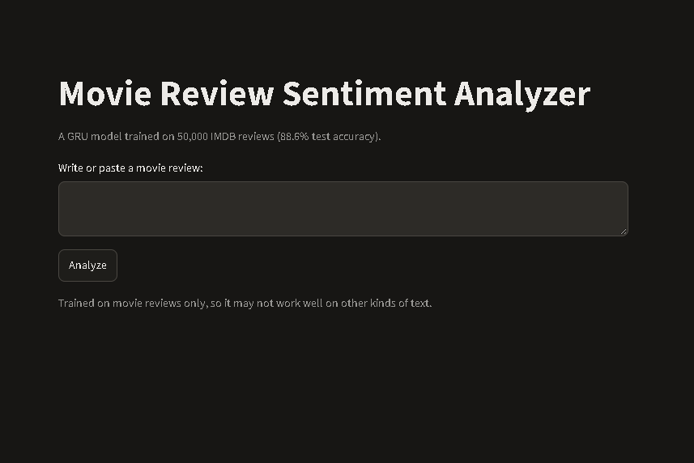
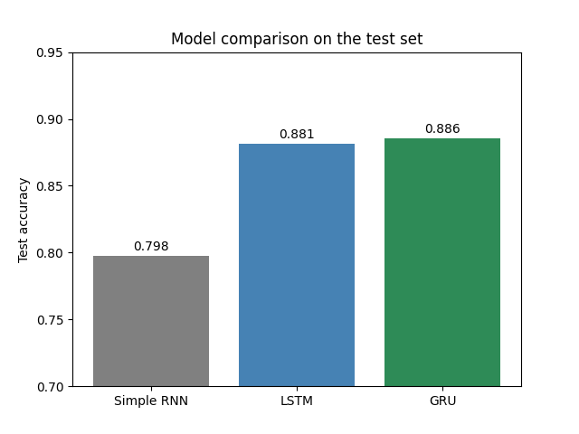
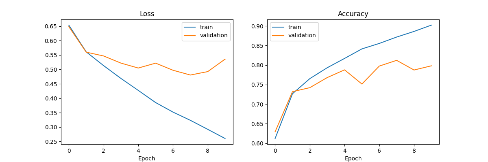
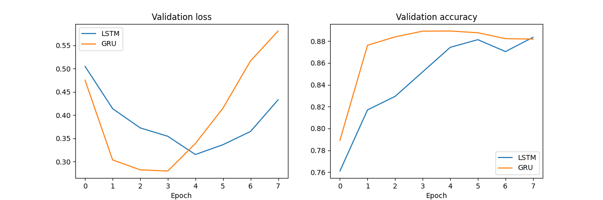
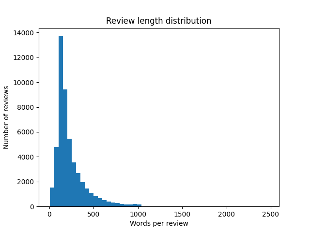

# Movie Review Sentiment Analysis (RNN, LSTM, GRU)

[](https://imdb-sentiment-rnn-007.streamlit.app/)

**Live demo: https://imdb-sentiment-rnn-007.streamlit.app/**

A deep learning project that classifies IMDB movie reviews as **positive** or **negative**. I built and compared three sequence models in PyTorch (Simple RNN, LSTM, GRU) and deployed the best one (GRU) as a live Streamlit app.



## Highlights

- Compared **Simple RNN vs LSTM vs GRU** under identical data, settings, and evaluation
- **GRU reached 88.6% test accuracy**, 8-9 points above the simple RNN baseline (79.8%)
- Clean evaluation: the vocabulary was built from the training set only, models were selected on the validation set, and the test set was used only for final evaluation
- Deployed as a working web app anyone can try

## Try it

Open the [live app](https://imdb-sentiment-rnn-007.streamlit.app/), paste a movie review, and click **Analyze**. If the app is asleep, click "Yes, get this app back up!" and wait about a minute.

Results from my own testing:

| Review | Prediction |
|---|---|
| "This movie was absolutely fantastic, the acting and the story were brilliant." | Positive (99.6%) |
| "Terrible film. Boring plot, awful acting, a complete waste of time." | Negative (100%) |
| "the movie is good but action scene is not too good." | Negative (67%, uncertain) |

## Results

Evaluated on a held-out test set of 7,438 reviews:

| Model | Parameters | Best validation accuracy | Test accuracy | Macro F1 |
|---|---|---|---|---|
| Simple RNN (baseline) | 2,593,153 | 81.2% | 79.8% | 0.798 |
| LSTM | 2,692,225 | 88.3% | 88.1% | 0.881 |
| **GRU (final)** | 2,659,201 | **88.9%** | **88.6%** | **0.886** |

- LSTM and GRU improved on the simple RNN by 8-9 points. Simple RNNs struggle to remember early words in long reviews.
- The GRU was chosen using validation accuracy, then confirmed on the test set.
- GRU also trained faster than LSTM (about 39s vs 57s for 8 epochs on a Colab T4 GPU).
- GRU and LSTM are close (about 0.5 points apart), and each was trained once, so I treat that gap as small.



### Final model (GRU) in detail

| Class | Precision | Recall | F1 |
|---|---|---|---|
| Negative | 0.89 | 0.87 | 0.88 |
| Positive | 0.88 | 0.90 | 0.89 |

It made 850 mistakes out of 7,438 reviews (470 negative reviews predicted positive, 380 positive reviews predicted negative), so errors are balanced across both classes.


### Training curves




All three models start overfitting after a few epochs (training accuracy keeps rising while validation loss goes up), so I saved the best epoch by validation accuracy instead of the last one.

## Dataset

[IMDB Dataset of 50K Movie Reviews](https://www.kaggle.com/datasets/lakshmi25npathi/imdb-dataset-of-50k-movie-reviews) (Kaggle), based on the Stanford Large Movie Review Dataset (Maas et al., 2011).

- 418 duplicate reviews were removed, leaving 49,582 reviews (24,884 positive, 24,698 negative), so the classes are balanced
- Review length: median 173 words, mean 231, maximum 2,470
- Split 70/15/15 into train, validation, and test, stratified by label (34,707 / 7,437 / 7,438)



## How it works

1. **Clean text:** lowercase, remove HTML tags, keep letters and apostrophes
2. **Vocabulary:** the 20,000 most common words, built from the training set only (`<PAD>` and `<UNK>` tokens added)
3. **Sequences:** each review is cut or padded to 300 words (padding at the start, so the model finishes on real words)
4. **Model:** Embedding (128) -> RNN / LSTM / GRU (hidden 128) -> Dropout -> Linear
5. **Prediction:** a sigmoid on the output gives the probability that the review is positive

## Training setup

| Setting | Value |
|---|---|
| Framework | PyTorch |
| Loss | Binary cross-entropy (with logits) |
| Optimizer | Adam, learning rate 1e-3 |
| Batch size | 64 |
| Epochs | 10 (Simple RNN), 8 (LSTM, GRU) |
| Dropout | 0.3 (Simple RNN), 0.4 (LSTM, GRU) |
| Regularization | Gradient clipping (max norm 1.0) |
| Model selection | Best epoch by validation accuracy |
| Hardware | Google Colab, T4 GPU |

## Project structure

```
app.py              Streamlit app
vocab.json          Word-to-number mapping used in training
requirements.txt    App dependencies
models/             Trained GRU weights (gru.pth)
notebooks/          Full training notebook
outputs/            Charts, screenshot, and result tables
```

## Run the app locally

```bash
git clone https://github.com/Its-Niraj-Code-Hub/imdb-sentiment-rnn.git
cd imdb-sentiment-rnn
pip install -r requirements.txt
python -m streamlit run app.py
```

## Reproduce the training

1. Download the [dataset](https://www.kaggle.com/datasets/lakshmi25npathi/imdb-dataset-of-50k-movie-reviews) from Kaggle
2. Upload `IMDB Dataset.csv` to Google Drive at `imdb-sentiment-rnn/data/`
3. Open the notebook in `notebooks/` in Google Colab, select a T4 GPU, and run the cells in order

## Limitations

- Trained on movie reviews only, so it may not work well on other kinds of text
- Mixed opinions are hard. For example, "the movie is good but action scene is not too good" was predicted negative with only 67% confidence
- Sarcasm and very short texts are unreliable
- The vocabulary is limited to 20,000 words, and reviews are cut at 300 words (about 22% of training reviews are longer)
- All three models overfit after a few epochs, so I kept the best epoch rather than the last
- Results come from a single training run per model

## Possible improvements

- Add a neutral or "mixed" class, since the model only chooses between positive and negative
- Try pretrained word embeddings (such as GloVe) and bidirectional layers
- Add early stopping and stronger regularization to reduce overfitting
- Repeat training with several random seeds to measure the real gap between LSTM and GRU

## Tech stack

Python, PyTorch, Pandas, scikit-learn, Matplotlib, Streamlit, Google Colab

## Author

Niraj Singh - [GitHub](https://github.com/Its-Niraj-Code-Hub) | [LinkedIn](https://www.linkedin.com/in/niraj-singh-6bbb99415/)